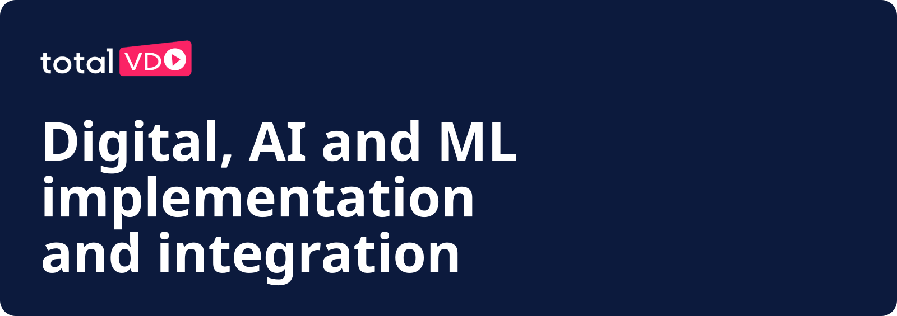
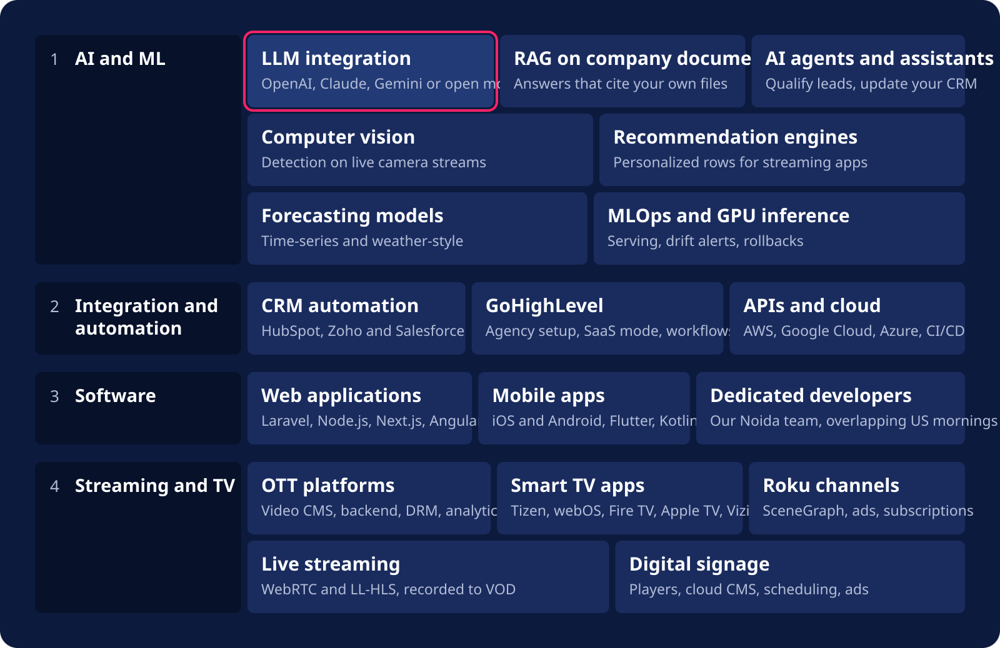
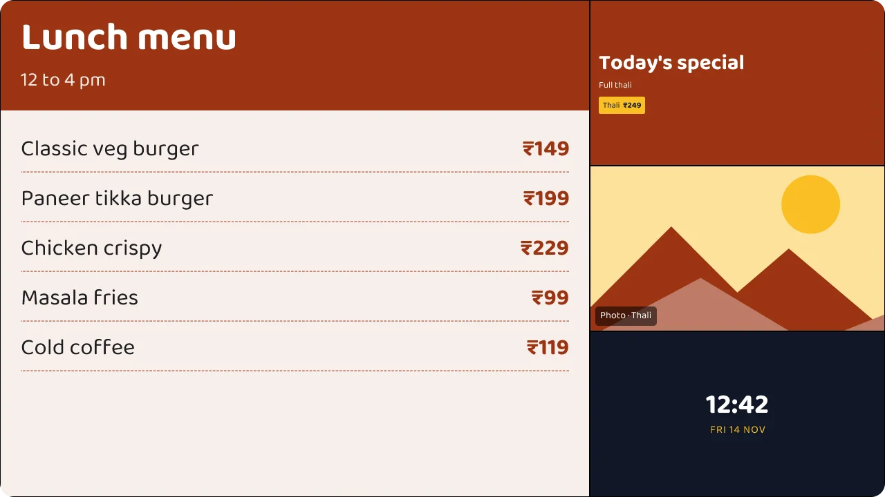
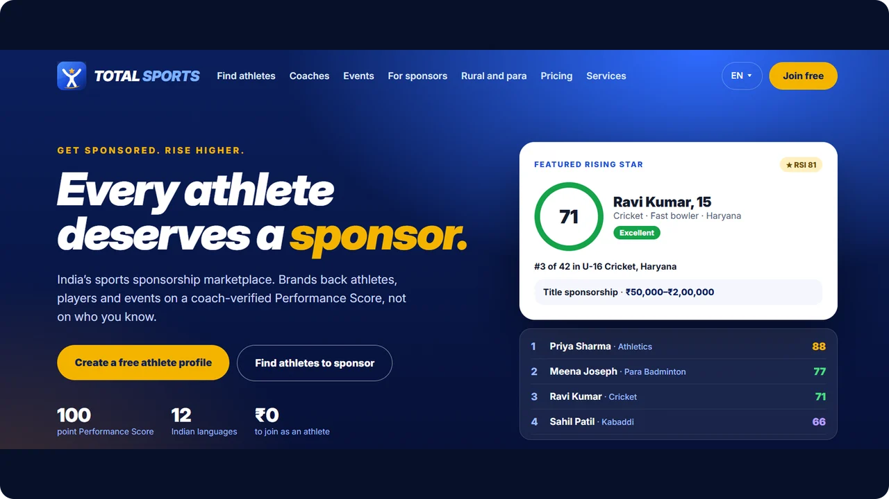

We put AI to work inside the systems you already run, connect your CRM, ERP, dashboards and apps, and build what is missing. OTT and smart TV app development is one of our core services.

100+ clients served, 300+ mobile apps delivered and 500+ TV and OTT channels developed by our team in Noida, Delhi NCR.

&nbsp;&nbsp;

## What we build

## Our own platforms

<table>
  <tr>
    <td width="50%" valign="top">
      
      <h3><a href="https://tscreentv.com/">TScreen TV</a></h3>
      Digital signage that turns smart TVs into managed screens for menus, notices, live scores and ads, run from one web dashboard. It works on Android TV, Fire TV, Roku, Samsung and LG smart TVs.
    </td>
    <td width="50%" valign="top">
      
      <h3><a href="https://totalsports.co.in/">Total Sports</a></h3>
      A sports sponsorship marketplace for India. Sponsors back junior, rural and para athletes, with AI matching, digital contracts, escrow payments and ROI reports.
    </td>
  </tr>
</table>

We also run IntegratedGHL, our GoHighLevel agency for agencies, coaches and small businesses.

Total VDO Solution, Noida, Delhi NCR, India. Monday to Friday, 9:00 to 18:00 IST. In the US, call +1 202-239-1479.
